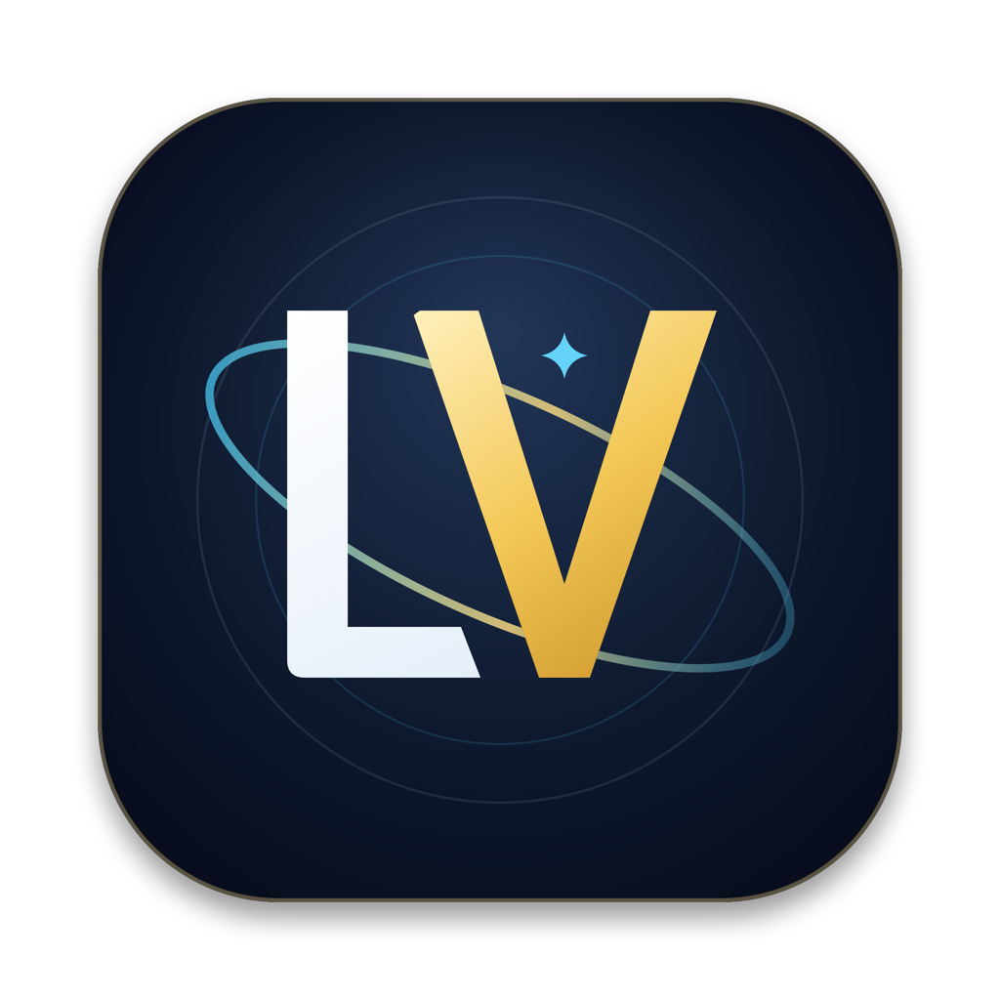
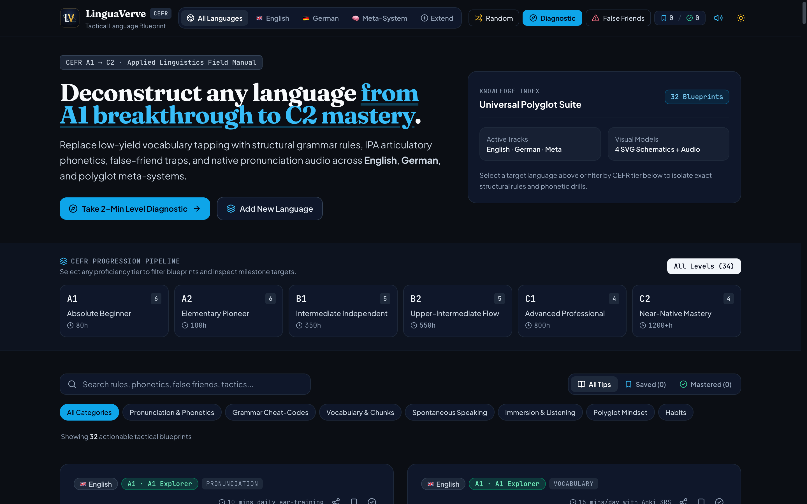

<div align="center">



# LinguaVerve

**The Polyglot's Intensive Academy & Tactical Blueprint**

Zero-to-Hero `A1 → C2` Intensive Courses · 4-Skill Certification Exam Simulators · Real-Exam Readiness Advisor · Human Multi-Speaker Voice Studio · On-Device, Local & Cloud AI Coaching

<p>
  <a href="./src/test"></a>
  <a href="./macos/Tests/LinguaVerveTests"></a>
  <a href="./apple/LinguaVerve.xcodeproj"></a>
  <a href="./.github/workflows/deploy.yml"></a>
  <a href="./.github/workflows/ci.yml"></a>
  <a href="./package.json"></a>
</p>

<p>
  <a href="#-complete-polyglot-mastery-suite">Features</a> ·
  <a href="#-human-voice--multi-accent-studio">Voice Studio</a> ·
  <a href="#-architecture">Architecture</a> ·
  <a href="#-quick-start">Quick Start</a> ·
  <a href="#-github-actions-ci-releases--auto-updater">Releases &amp; CI</a>
</p>

</div>

---

<table>
  <tr>
    <td width="50%" align="center">
      
      <br />
      <sub><strong>Native Apple App</strong> — Golden Gate Editorial UI on macOS, iPadOS &amp; iOS</sub>
    </td>
    <td width="50%" align="center">
      
      <br />
      <sub><strong>Web SPA Studio</strong> — Zero-backend React + TypeScript + Tailwind</sub>
    </td>
  </tr>
</table>

---

## At a Glance

| Pillar | Scope in Repo |
| :--- | :--- |
| **Intensive Courses** | **12** full `A1 → C2` courses (6 English + 6 German) · **72** guided curriculum units |
| **4-Skill Mock Exams** | **12** built-in timed certification exams + **unlimited AI-generated** multi-part exams |
| **Placement Pre-Test** | **24** progressive `A1 → C2` items across Reading, Listening, Writing &amp; Speaking |
| **Official Exam Portals** | **24** verified links (Goethe-Institut, telc, TestDaF, ÖSD, Cambridge, IELTS, TOEFL) |
| **Tactical Field Manual** | **32** polyglot blueprints · **4** interactive visual diagrams · **10** False Friends |
| **Automated Test Suite** | **109** passing tests (**66** Web Vitest + **43** Native Swift XCTest) |

---

## 🌟 Complete Polyglot Mastery Suite

### 1. 🎓 Zero-to-Hero Intensive Courses (`A1 → C2`)
- **72 Guided Units across 12 Courses:** Structured multi-week syllabi for **English (`A1–C2`)** and **German (`A1–C2`)**, extensible to Spanish, French, Japanese, and beyond.
- **5-Step Interactive Unit Lesson Player:** Progress smoothly through **1. Concept & Grammar → 2. Audio Flashcards → 3. Knowledge Check → 4. 4-Skill Drills → 5. Milestone Checkpoint** with persistent per-unit progress and one-click advancement to the next unit or CEFR tier.
- **24 Official Certification & Mock Test References:** Direct links to **Goethe-Institut**, **telc Deutsch**, **TestDaF**, **ÖSD**, **Deutsche Welle** (*Nicos Weg*, *Top-Thema*), **vhs-Lernportal**, **Cambridge English** (`A2 Key`–`C2 Proficiency`), **IELTS**, **ETS TOEFL iBT**, **BBC Learning English**, and **British Council LearnEnglish**.

### 2. 🎯 Scored 4-Skill Placement Pre-Test & Collective Course Recommender
- **24 progressive `A1 → C2` diagnostic items** testing Reading, Listening/Hearing (spoken audio with replay caps), Writing/Grammar, and Speaking Pragmatics.
- Pinpoints your authentic CEFR tier and skill gaps, then automatically prescribes and enrolls a **Collective Multi-Course Study Bundle** (*Foundation Reinforcement + Core Intensive + Bridge to Next Tier*).

### 3. ⏱️ High-Pressure 4-Skill Simulated Exam Arena (`12 Built-In` + `AI Exam Generator`)
- **12 Timed Certification Simulations:** Mirrors real Goethe-Zertifikat, telc, TestDaF, Cambridge, IELTS, and TOEFL structures across Reading, Listening, Writing, and Speaking.
- **On-Demand AI Exam Generator:** Synthesizes fresh, themed multi-part exams with automatic cloze-gap validation/repair and offline fallbacks.
- **Strict Exam Pressure Mode vs. Practice Mode:** Live countdown clock with auto-submit, strict audio replay caps (`2x` for A1–B2, `1x` for C1–C2), locked transcripts until submission, live word counter, prep & speaking timers, and microphone Speech-to-Text dictation.
- **AI-Powered 4-Skill Examiner Assessment & Past Attempt Inspector:** Click any past attempt to inspect every question alongside AI examiner rubric scores, inline corrections, upgraded model answers, and targeted study plans.

### 4. 🛡️ Real-Exam Readiness Advisor
- Synthesizes your simulated exam history across levels and skills (`Reading`, `Listening`, `Writing`, `Speaking`) into a clear **Readiness Verdict** (*Ready for Real Exam*, *Almost Ready · Short Polish*, or *More Practice Needed*).
- Surfaces skill trends, bottleneck skills, and one-click launches directly into targeted AI Coaching or a fresh re-test.

### 5. 🤖 On-Device, Local & Cloud AI Coaching
- **Apple Intelligence On-Device Foundation Model:** Uses `FoundationModels.framework` on macOS 26 / iPadOS 26 / iOS 26 for zero-API-key, 100% private offline coaching and evaluation.
- **Local & Cloud AI with Live Model Discovery:** Connect **Ollama**, **LM Studio**, **OpenAI**, **Google Gemini**, **OpenRouter**, or any custom OpenAI-compatible endpoint (Groq, Mistral, vLLM, etc.), fetch live model catalogs across providers, and fall back gracefully to an offline CEFR rubric evaluator when disconnected. `NSAllowsLocalNetworking` also allows iPhone/iPad apps to reach Ollama/LM Studio running on your Mac over Wi-Fi.

### 6. 📊 Progress Dashboard, Backup & Tactical Field Manual
- **Persistent Progress & JSON Backup:** Saves completed units, guided lesson steps, Pre-Tests, Simulated Exam scorecards, AI assessments, readiness reports, and daily study streaks with one-click JSON export/import.
- **Tactical Field Manual:** **32** polyglot cheat-codes, **4** interactive visual models (*Preposition Pyramid*, *German Gender Suffix Matrix*, *Wechselpräpositionen Movement*, *Articulatory Phonetics*), and **10** False Friends cards.

---

## 🎙️ Human Voice & Multi-Accent Studio

Designed to sound genuinely human across **6 English accents** (`en-GB`, `en-US`, `en-AU`, `en-IE`, `en-IN`, `en-ZA`), **3 German DACH accents** (`de-DE`, `de-AT`, `de-CH`), plus **Spanish** and **French**—with `0.75x` slow / `1.0x` normal playback, **4 expressive styles** (*Natural Human*, *Language Coach*, *Conversational*, *News Broadcast*), adaptive conversational turn pauses, and **persistent offline audio caching** (`Caches/LinguaVerveAudioCache` on Apple, `CacheStorage` on Web).

| Engine | Mode | Multi-Speaker & Human Prosody Highlights | Key / Setup |
| :--- | :--- | :--- | :--- |
| **Google Gemini 2.5 TTS**<br/>`gemini-2.5-flash-preview-tts` | Cloud | Renders **2-speaker dialogues in a single API call** (`multiSpeakerVoiceConfig`) with real breaths, reactions & 24kHz PCM→WAV output | Reuses Gemini AI key (`x-goog-api-key`) |
| **OpenAI Human TTS**<br/>`gpt-4o-mini-tts` | Cloud | Accent-coached voices (`coral`, `sage`, `ash`, etc.) with **previous-speaker turn context** in dialogue prompts | Reuses OpenAI AI key |
| **ElevenLabs**<br/>`eleven_v3` · `v2` · `Flash v2.5` | Cloud | Expressive style presets, `previous_text` / `next_text` turn continuity, speed control (`v2`/`Flash`), and `language_code` locking | ElevenLabs `xi-api-key` |
| **Local Apple Silicon TTS**<br/>`mlx-audio` · `Kokoro` · `Piper` | 100% Private Local | 1-click presets for **MLX-Audio** (`localhost:8000` Kokoro-82M & Chatterbox Multilingual), **Kokoro-FastAPI** (`:8880`), and **Speaches/Piper** (German `Thorsten`/`Eva`), plus **Test Local Server** health check | Zero API key · Local daemon |
| **On-Device Neural**<br/>Apple Siri/Premium · Browser | 100% Free Offline | Filters out legacy robotic/Eloquence voices, preserves pure `1.0` pitch on neural voices (no metallic shifting), and includes guided Apple Premium voice setup for English & German | Built-in · Zero setup |

---

## 🧩 Architecture

```text
src/data/  (Single Source of Truth: courses, 72 guided units, 12 mock exams, 32 tips, pre-tests)
   │
   ├─► Web SPA (React 18 + TypeScript + Vite + Tailwind) ──► ./dist (GitHub Pages)
   │
   └─► node scripts/export-curriculum.mjs ──► macos/Sources/LinguaVerveCore/Resources/curriculum.json
          │
          ├─► LinguaVerveCore  (Models, Store, AI/TTS Engines, Speech, GitHub Auto-Updater)
          └─► LinguaVerveUI    (Golden Gate Editorial SwiftUI: macOS 14+ · iPadOS 17+ · iOS 17+)
```

---

## 🚀 Quick Start

### 🌐 Web SPA
```bash
npm install
npm run dev      # Start local Vite dev server
npm test         # Run Web Vitest suite (66 tests across 6 files)
npm run build    # Type-check & build static bundle -> ./dist
npm run preview  # Preview production build locally
```

### 🍎 Native Apple Apps (MacBook · iPad · iPhone)
Requires **macOS 14+**, **Xcode** (auto-selected via [`scripts/select-xcode.sh`](./scripts/select-xcode.sh)), and **Node.js**. No paid Apple Developer account is required for local builds (ad-hoc signed).

```bash
# macOS App (fastest local iteration)
npm run macos:launch:fast # Host-arch release rebuild + clean launch of dist-macos/LinguaVerve.app
npm run macos:open        # Launch already-built dist-macos/LinguaVerve.app without rebuilding
npm run macos:launch      # Full Universal (arm64 + x86_64) .app/.dmg/.zip/SHA256SUMS.txt & launch
npm run macos:app         # Package Universal macOS release artifacts in dist-macos/
npm run macos:test        # Sync curriculum.json & run native Swift XCTests (43 tests)
npm run macos:sync        # Export src/data/ -> curriculum.json

# Universal Xcode Project (macOS · iPadOS · iOS)
npm run apple:xcode       # Sync curriculum, generate icons + LinguaVerve.xcodeproj, test & build iOS/macOS
npm run apple:open        # Open apple/LinguaVerve.xcodeproj in Xcode
```

#### Optional: Local Neural Voices on Apple Silicon (`mlx-audio`)
```bash
pip install mlx-audio[tts] && mlx_audio.server --port 8000
```
Then open **Voice & Accent Studio → Local Neural TTS → MLX-Audio (Apple Silicon) → Test Local Server**.

---

## 🚢 GitHub Actions CI, Releases & Auto-Updater

- **Web Deployment ([`deploy.yml`](./.github/workflows/deploy.yml)):** Configured with `base: './'` in [`vite.config.ts`](./vite.config.ts). Pushes to `main` run the `betterleaks` secret scan, `npm run test`, and `npm run build`, then publish `./dist` to GitHub Pages.
- **CI Native Apple & Web ([`ci.yml`](./.github/workflows/ci.yml)):** Every PR (and any `[skip release]` push) runs on `macos-26` to execute Web Vitest + Swift XCTests, build Universal macOS (`.dmg` + `.zip`) and unsigned iOS/iPadOS (`.ipa`) artifacts, verify `FoundationModels.framework` linkage and `SHA256SUMS.txt`, and upload downloadable build artifacts.
- **Automatic Push-to-Main Releases & In-App Auto-Updater ([`release.yml`](./.github/workflows/release.yml) + [`scripts/next-release-version.mjs`](./scripts/next-release-version.mjs)):** Pushing app changes to `main` automatically computes the next semantic version tag from Conventional Commits (`BREAKING CHANGE` / `!:` → major, `feat:` → minor, `fix:` / other changes → patch), builds & verifies Universal macOS `.dmg`/`.zip`, unsigned iOS/iPadOS `.ipa`, and `SHA256SUMS.txt`, creates the git tag at the tested commit SHA, and publishes the GitHub Release — no manual `git tag` needed. Docs/workflow-only pushes skip automatically (add `[force release]` to override, or `[skip release]` to skip an app commit; preview locally with `npm run release:next`). Existing macOS installs check GitHub Releases automatically on launch (and every 6 hours), verify `SHA256SUMS.txt`, swap `LinguaVerve.app` atomically with rollback protection, and relaunch.
  - *First-launch Gatekeeper note for downloaded `.dmg`/`.zip` builds (ad-hoc signed):* use the bundled `Install LinguaVerve (No Apple Dev Account).command` inside the `.dmg`, or run `xattr -cr /Applications/LinguaVerve.app`.
