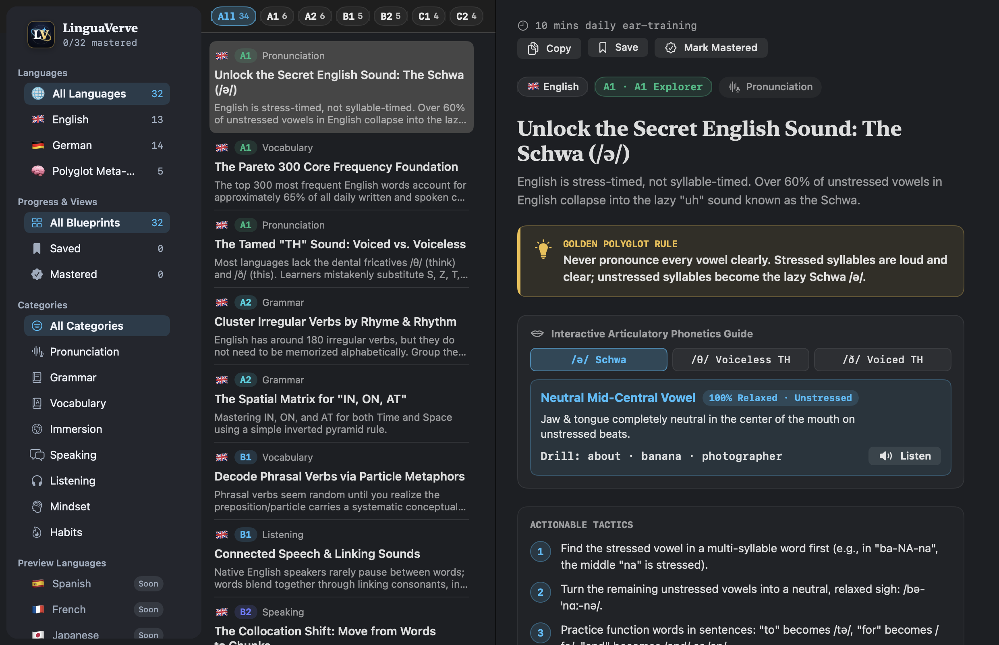
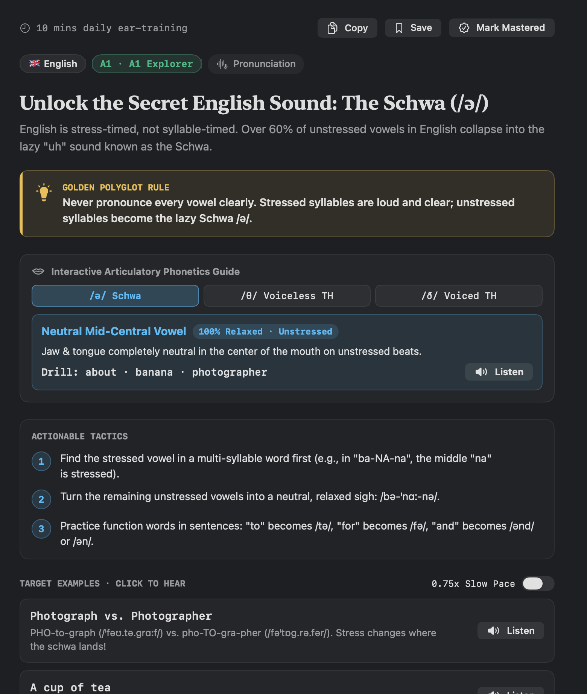
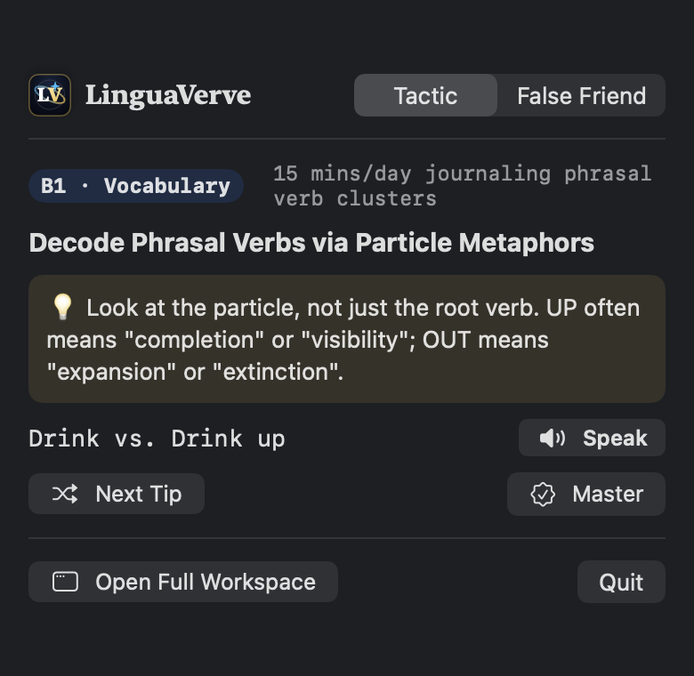
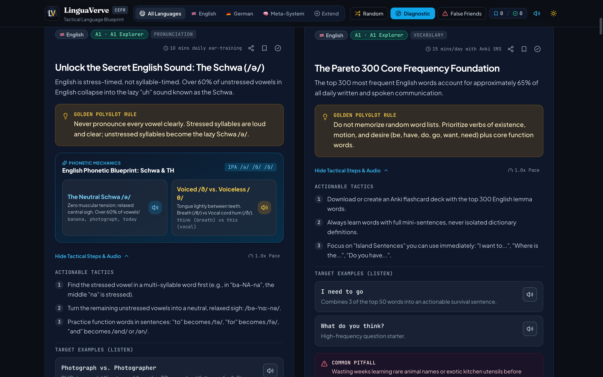
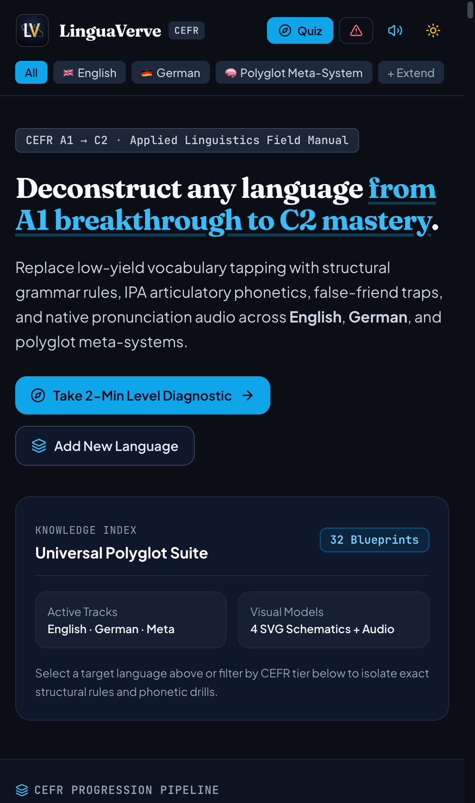

<div align="center">
  
  <h1>LinguaVerve</h1>
  <p><strong>The Polyglot's Tactical Blueprint</strong> — High-leverage language acquisition strategies from <strong>A1 Breakthrough</strong> to <strong>C2 Mastery</strong> for English, German, and beyond — built for both the <strong>Web</strong> and <strong>Native macOS</strong>.</p>

  <p>
    <a href="./src/test"></a>
    <a href="./macos/Tests"></a>
    <a href="./macos"></a>
    <a href="./.github/workflows/deploy.yml"></a>
    
  </p>
</div>

---

## 🖼️ Visual UI Showcase

### Native macOS App (`SwiftUI` + `MenuBarExtra`)

A three-column native macOS workspace with system typography, interactive articulatory phonetics, native `NSSpeechSynthesizer` pronunciation playback, and a quick-study menu bar companion.

<p align="center">
  
</p>

| Interactive Phonetics Inspector | MenuBarExtra Quick-Study Popover |
| :---: | :---: |
|  |  |
| *Typography-first blueprint reader with Golden Polyglot Rule callouts, interactive IPA mouth/tongue selector, and actionable drills.* | *Always-available menu bar companion switching live between daily tactics and False Friends traps.* |

---

### Responsive Web App (`React` + `Tailwind CSS`)

Designed around an editorial dark/light palette, adaptive container spacing across viewports, interactive CEFR progression pipeline, and rich structural diagrams.

<p align="center">
  
</p>

| Tactical Blueprints & Interactive SVG Schematics | Balanced Mobile Experience (`390×844`) |
| :---: | :---: |
|  |  |
| *Two-column tactical blueprint grid with embedded SVG phonetics/case schematics and native audio speech synthesis.* | *Reflows cleanly without horizontal overflow on narrow phones and tablets.* |

---

## 🌟 Why LinguaVerve?

Most language platforms keep learners trapped in endless, low-yield vocabulary taps without building true conversational instinct.

**LinguaVerve** treats language acquisition as an engineering discipline: high-leverage structural cheat-codes, IPA phonetic muscle memory, interactive SVG schematics, and deceptive-cognate guardrails across every CEFR proficiency tier (**A1, A2, B1, B2, C1, C2**).

---

## ⚡ Core Features

- **🇩🇪 German Tactical Knowledge Base (A1 → C2):**
  - **A1:** The 80% Noun Suffix cheat-code (`-ung`, `-heit`, `-keit`, `-chen`), the iron V2 verb order rule, and the two CH sounds (`[ç]` vs. `[x]`).
  - **A2:** The 4-case system demystified (why only masculine shifts in Akkusativ), two-way prepositions (*Wechselpräpositionen*), and separable verb launchpads.
  - **B1:** The subordinate verb-kicker (*weil*, *dass*, *obwohl*), and courteous *Konjunktiv II*.
  - **B2:** The secret spice of native German: *Modalpartikeln* (*doch*, *ja*, *mal*, *halt*), and the 2-step adjective ending logic (no 48-cell grids).
  - **C1:** Academic *Nominalstil* and extended participial bracket constructions (*Partizipialattribute*).
  - **C2:** Idiomatic mastery (*Redewendungen*), philosophical cadence, and *Konjunktiv I* for journalistic distance.

- **🇬🇧 English Tactical Knowledge Base (A1 → C2):**
  - **A1:** Rhythmic stress-timing and the ubiquitous Schwa (`/ə/`), Pareto 300 lemma foundation, and voiced vs. voiceless `TH`.
  - **A2:** Irregular verbs grouped by rhyming vowel patterns, and the spatial pyramid for `IN, ON, AT`.
  - **B1:** Phrasal verb decoding through conceptual particle metaphors (`UP` = completion, `OUT` = expansion).
  - **B2:** Collocation mastery (moving from isolated words to authentic chunks), and the 1.25x unscripted audio cascade.
  - **C1:** Stylistic negative adverb inversion (*"Rarely have I seen..."*), and nuanced hedging discourse markers (*albeit*, *nonetheless*).
  - **C2:** Decoding British understatement, pragmatic irony, and speech prosody.

- **🧠 Polyglot Meta-System:**
  - Professor Arguelles' Shadowing technique for accent elimination.
  - The Conversational Island method for early impromptu speaking.
  - Krashen's `i + 1` comprehensible input doctrine.
  - Atomic spaced repetition (Anki) best practices.
  - Smashing the notorious B2 plateau.

- **🎯 Interactive CEFR Diagnostic Level Finder:**
  - 4-step diagnostic assessment calculating your current CEFR tier with one-click filtering.

- **⚠️ False Friends & Deceptive Cognates Cheat-Sheet:**
  - Searchable guide for dangerous traps like *Gift* (Poison, not present!), *bekommen* (to receive, not to become), *aktuell* (current, not actual), *prägnant*, *brav*, and *Chef*.

- **💾 Persistent Progress & Offline Resilience:**
  - Web persists bookmarks, mastered blueprints, and theme preference in `localStorage`.
  - macOS persists progress in `UserDefaults` with zero network dependencies.

---

##  Native macOS App (`SwiftUI` + `MenuBarExtra`)

LinguaVerve ships a first-class Swift 6 / SwiftUI native macOS application under [`./macos/`](./macos/) backed by the exact same curriculum dataset exported directly from TypeScript (`scripts/export-curriculum.mjs` → `macos/Sources/LinguaVerveCore/Resources/curriculum.json`).

### One-Command Sync & Launch

Run from the repository root on **macOS 14+** (builds the release binary, embeds `AppIcon.icns`, bundles `dist-macos/LinguaVerve.app`, and opens it):

```bash
npm run macos:launch
```

### Additional macOS Commands

```bash
# 1. Export latest TypeScript curriculum data to Swift resources
npm run macos:sync

# 2. Sync curriculum & run the Swift XCTest suite (CurriculumStoreTests)
npm run macos:test

# 3. Sync curriculum & build the Swift release binary
npm run macos:build

# 4. Assemble standalone dist-macos/LinguaVerve.app bundle without launching
npm run macos:app
```

### Keyboard Shortcuts

| Shortcut | Action |
| :---: | :--- |
| `⌘R` | Jump to a random tactical blueprint |
| `⌘D` | Open the 4-step CEFR Diagnostic Level Finder |
| `⇧⌘F` | Open False Friends & Deceptive Cognates |
| `⌘0` | Reset all language, CEFR, and category filters |

---

## 🚀 Web App Quick Start

### 1. Clone & Install
```bash
git clone https://github.com/your-username/lingua-verve.git
cd lingua-verve
npm install
```

### 2. Start Dev Server
```bash
npm run dev
```
Visit `http://localhost:5173` in your browser.

### 3. Run Automated Tests
```bash
npm test
```
Runs the Vitest suite validating data completeness, CEFR coverage, filters, and UI components.

### 4. Build Production Static Bundle
```bash
npm run build
```
Outputs an optimized, zero-backend static site to `./dist`.

---

## 🚢 Deploying to GitHub Pages

LinguaVerve is configured for seamless deployment to GitHub Pages via `./dist` and relative path asset resolution (`base: './'` in `vite.config.ts`).

### Automated Deployment (GitHub Actions)
The included workflow file [`.github/workflows/deploy.yml`](./.github/workflows/deploy.yml) automatically builds, tests, and deploys every push to the `main` branch.

1. Push this repository to GitHub.
2. In your GitHub repository, navigate to **Settings** → **Pages**.
3. Under **Build and deployment** → **Source**, select **GitHub Actions**.
4. Push a commit or trigger the workflow under the **Actions** tab — your site will be live in ~60 seconds!

---

## 🧩 Adding a New Language (Extensibility Guide)

Adding another target language (e.g. Spanish, French, Italian, Japanese) requires only 3 steps — and both the Web SPA and macOS native app will pick it up cleanly via `npm run macos:sync`:

### Step 1: Register in `src/data/languages.ts`
```typescript
export const LANGUAGES: Language[] = [
  // ...
  {
    id: 'spanish',
    name: 'Spanish',
    nativeName: 'Español',
    flag: '🇪🇸',
    tagline: 'The Expressive Romance Tongue',
    description: 'Subjunctive mood mastery, rolled R phonetics, and rapid cadence.',
    family: 'Romance',
    estimatedHoursToC1: 600,
    difficultyRating: 'Category I',
    status: 'active' // change from 'preview' to 'active'
  }
];
```

### Step 2: Create `src/data/tips/spanish.ts`
```typescript
import { TipItem } from '../../types';

export const SPANISH_TIPS: TipItem[] = [
  {
    id: 'es-a1-rolled-r',
    title: 'The Mechanical Rolled R: Tongue Relaxation Drill',
    languageId: 'spanish',
    level: 'A1',
    category: 'pronunciation',
    summary: 'Master the alveolar trill by releasing tension at the gum ridge.',
    goldenRule: 'Blow air with a completely relaxed tongue tip rather than forcing it.',
    tactics: [
      'Say "butter" rapidly in American English to locate the tapping alveolar spot.',
      'Exhale air while lightly fluttering the tongue tip against the roof.'
    ],
    commonPitfall: 'Using throat friction like a French R.',
    timeCommitment: '5 mins/day',
    tags: ['pronunciation', 'rolled-r', 'phonetics']
  }
  // Add tips across A1, A2, B1, B2, C1, C2
];
```

### Step 3: Export in `src/data/index.ts`
```typescript
import { SPANISH_TIPS } from './tips/spanish';

export const ALL_TIPS: TipItem[] = [
  ...ENGLISH_TIPS,
  ...GERMAN_TIPS,
  ...SPANISH_TIPS,
  ...META_TIPS
];
```

All filters, level roadmaps, search indexes, Vitest invariants, and the synced `macos` curriculum bundle will automatically integrate the new language.

---

## 🧪 Testing Architecture

- **Web Suite ([`./src/test/`](./src/test/))** — `npm test`
  - `data.test.ts`: Validates schema integrity, active language availability, complete CEFR level coverage (`A1`–`C2`), and search/filter algorithms.
  - `components.test.tsx`: Validates UI rendering, language switching, bookmark/mastered state mutations, and interactive modal workflows.
- **Native macOS Suite ([`./macos/Tests/`](./macos/Tests/))** — `npm run macos:test`
  - `CurriculumStoreTests.swift`: Validates bundle parity, CEFR & category filtering, false-friend search, diagnostic state transitions, and persistence across launches.

---

## 📜 License
MIT License. Built with ❤️ for the global polyglot community.
